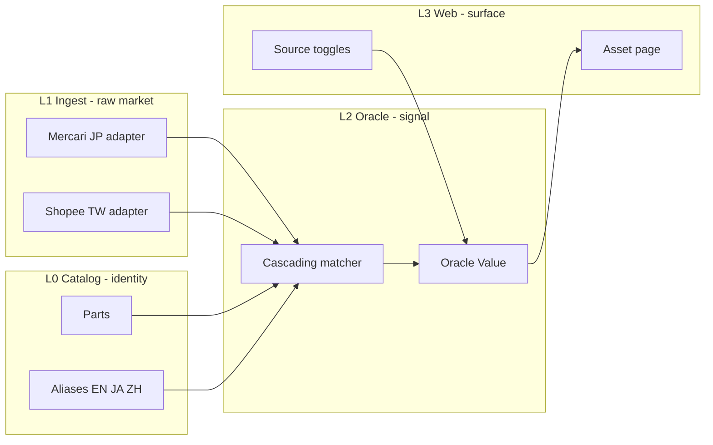

# 03 — Architecture

[← Blueprint index](README.md) · Prev: [02-landscape](02-landscape.md) · Next: [04-data-model](04-data-model.md)

## The thesis in one idea

**Marketplaces are disposable; identity and the mark are not.**

Every scraper we write will eventually break — an endpoint changes, a ToS
tightens, a site adds bot defence. So the architecture isolates that churn.
Adapters are replaceable behind one interface, raw payloads are persisted so
matching can be re-run without re-fetching, and the valuation layer never talks
to a marketplace directly.

## Four layers

Borrowed from [PokeDao](https://github.com/ChicoPanama/PokeDao)'s L0–L3 split.



Each layer only depends on the one to its left. A broken adapter degrades
coverage; it cannot corrupt the catalog or crash the UI.

## Packages

| Package | Layer | Responsibility | Key files |
|---|---|---|---|
| `packages/shared` | — | Types, generation taxonomy, FX, source bitmasks | `src/index.ts` |
| `packages/catalog` | L0 | Seed parts, aliases, fixtures; loaders | `src/load.ts`, `data/` |
| `packages/db` | L0–L2 | Drizzle Postgres schema and migrations | `src/schema.ts` |
| `packages/ingest` | L1 | `PricingSource` interface and adapters | `src/types.ts`, `src/adapters/` |
| `packages/oracle` | L2 | Matcher and Oracle Value | `src/matcher.ts`, `src/oracle-value.ts` |
| `apps/web` | L3 | Next.js App Router UI and route handlers | `src/app/`, `src/lib/data.ts` |

Dependencies point one way: `web → oracle → catalog → shared`, with `ingest`
depending on `catalog`, `oracle`, and `shared`.

## The provider interface

Adapted from [tcg_mcp](https://github.com/seanlok/tcg-mcp)'s pricing Protocol.
Every marketplace implements the same three members, defined in
[`packages/ingest/src/types.ts`](../packages/ingest/src/types.ts):

```typescript
export interface PricingSource {
  readonly id: SourceId;
  search(query: string, opts?: SearchOpts): Promise<RawListing[]>;
  normalize(raw: RawListing): ObservationDTO;
}
```

Adding a venue means writing one class and registering it in
[`packages/ingest/src/pipeline.ts`](../packages/ingest/src/pipeline.ts). Nothing
in `oracle` or `web` changes. Adding Yahoo Auctions should touch exactly two
files plus a bitmask entry.

## Fixture-first, live-gated

Every adapter ships with JSON fixtures and reads them by default. Live paths
are enabled per-source by env var and **fall back to fixtures on failure**
unless `MERCARI_STRICT=1`.

This is what keeps CI honest: `pnpm test` and `pnpm ingest:fixtures` never
depend on a marketplace being up, and a contributor with no API access can
still run the whole stack. See [11-verification](11-verification.md).

## The live Mercari path

[`packages/ingest/src/adapters/mercari/`](../packages/ingest/src/adapters/mercari/)
is the reference implementation for a real adapter.

- `dpop.ts` builds an RFC 9449 DPoP proof: an ES256 JWT over an ephemeral P-256
  key, carrying the request method and URI, with the public JWK inlined in the
  header. Node emits DER signatures by default, so it passes
  `dsaEncoding: "ieee-p1363"` to get the raw r‖s pair ES256 requires.
- `client.ts` throttles to a minimum interval, retries 429 and 5xx with
  exponential backoff, paginates via `nextPageToken`, dedupes by item ID, and
  maps Mercari's six-level `itemConditionId` onto our four-way axis.

No account, token, or paid parser is involved. Sold time is approximated by the
item's `updated` timestamp, since Mercari exposes no explicit sale timestamp.

## Source toggles without re-fetching

Sources are a bitmask in
[`packages/shared/src/index.ts`](../packages/shared/src/index.ts)
(`mercari_jp = 1`, `shopee_tw = 2`). Toggling a source recomputes the mark from
**already-stored comps** — it never triggers a new fetch. That keeps the
interaction instant and makes the toggle safe to expose publicly.

## Deliberate deferrals

Present in the plan, absent from the code, and fine for now:

- **BullMQ and Redis** for scheduled ingest. Ingest is currently CLI-driven.
- **Postgres in the read path.** The web app reads catalog and fixtures from
  JSON, so the UI runs with no database at all.

Neither blocks correctness work, and both are cheap to add once matching is
fixed. Rationale in [09-decisions](09-decisions.md).

---

See also: [04-data-model](04-data-model.md) · [05-sources](05-sources.md) · [07-oracle-value](07-oracle-value.md)
