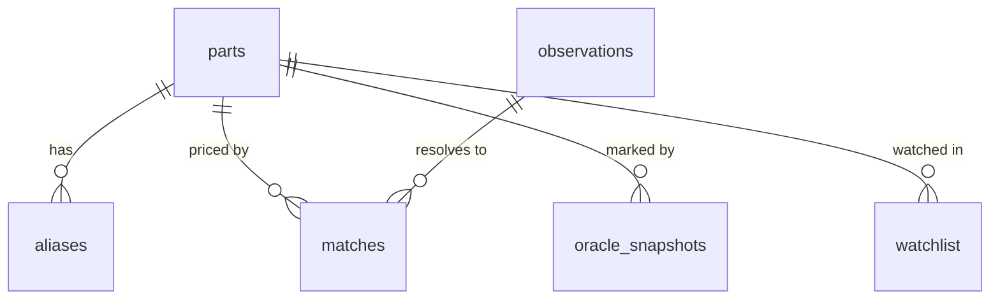

# 04 — Data model

[← Blueprint index](README.md) · Prev: [03-architecture](03-architecture.md) · Next: [05-sources](05-sources.md)

Schema: [`packages/db/src/schema.ts`](../packages/db/src/schema.ts).
Types: [`packages/shared/src/index.ts`](../packages/shared/src/index.ts).
The two must stay in step — shared DTOs mirror the Drizzle tables by hand.

## Entities

| Table | Holds | Notes |
|---|---|---|
| `parts` | Canonical identity | `id`, generation, part type, EN/JA/ZH names, product codes |
| `aliases` | Matching fuel | One row per locale per surface form |
| `observations` | Raw market events | Unique on `(source, external_id)`; keeps `raw_json` |
| `matches` | Listing → part links | Carries `confidence` and `method` |
| `oracle_snapshots` | Cached marks | Unique on `(asset_id, sources_mask)` |
| `watchlist` | Saved parts | Keyed by `session_id`, no user accounts yet |

`observations.raw_json` is deliberately retained so the matcher can be re-run
over historical payloads without re-fetching. Treat it as the source of truth
for any future re-matching pass.

## Generations and part types

There is no universal part taxonomy. Each generation decomposes differently, so
`PART_TYPES` in `shared` is keyed by generation and `parts.part_type` is a plain
string constrained per generation rather than a global enum.

| Generation | Part types | Code prefix |
|---|---|---|
| `plastic` | attack_ring, weight_disk, blade_base, spinning_gear | A-##, varies |
| `metal` | face, clear_wheel, metal_wheel, spin_track, performance_tip | BB## |
| `burst` | layer, forge_disc, driver | B-## |
| `x` | blade, ratchet, bit | BX-##, UX-##, CX-## |

Current seed: **28 parts** — 7 X, 8 Burst, 6 Metal, 7 Plastic.

## Identity keys

Ranked by reliability, which is also the matcher's cascade order:

1. **Product code** (`BX-01`, `B-34`, `BB28`). Hard key, language-independent.
   One caveat: a code identifies a *product*, and a product contains several
   parts, so a code alone cannot disambiguate blade from ratchet from bit.
2. **Alias text** per locale. The workhorse for real listings.
3. **Fuzzy similarity**. Currently broken for CJK — see
   [06-matching](06-matching.md).

**Current alias coverage is the project's weakest link:** only 19 alias rows
for 28 parts, of which 9 are English, 8 Japanese, and 2 Chinese. Nineteen of
28 parts have no alias at all. Chinese coverage is near-zero despite Shopee TW
being a day-one corridor.

## Conditions

Four values: `sealed`, `like_new`, `used`, `unknown`. Marketplace grades are
mapped in, not stored raw.

Mercari's `itemConditionId` maps as 1 → `sealed`, 2 → `like_new`, 3–6 → `used`,
absent → `unknown`. Title-text inference for other sources lives in
`inferConditionFromTitle()` in
[`packages/ingest/src/types.ts`](../packages/ingest/src/types.ts). Vocabulary
is in [08-glossary](08-glossary.md).

**Known gap:** condition is recorded but the oracle ignores it, so a sealed
retail sale and a scuffed used part land in the same median. See
[07-oracle-value](07-oracle-value.md).

## Sources as a bitmask

`mercari_jp = 1`, `shopee_tw = 2`. A snapshot is unique on
`(asset_id, sources_mask)`, so each source combination caches independently and
toggling never re-fetches. New sources take the next power of two.

## Currency

Observations store native currency — JPY for Mercari, TWD for Shopee. Conversion
happens at read time via `convertCurrency()`.

**This is a stub.** `FX_RATES` in `shared` is a hardcoded table, and conversion
uses today's rate rather than the rate at time of sale, which distorts any
long-run chart across a moving exchange rate. Replace with a dated FX series
before charts are trusted.

## What the model does not yet capture

Each of these is a real modelling gap, not an oversight to rediscover:

- **Bundles.** No flag distinguishes a single part from a 20-piece lot, though
  ~38% of live listings are lots. Detection exists (`looksLikeBundle()`), storage
  does not.
- **Products.** Only parts exist. A sealed `BX-01` box is not representable, so
  a product-code match must guess which part it means.
- **Combos.** No recipe entity. v1 sums part marks and says so.
- **Fakes and bootlegs.** Common in this market, unmodelled.
- **Shipping.** Mercari prices usually include domestic shipping; Shopee's
  usually do not. Not normalised.

---

See also: [06-matching](06-matching.md) · [07-oracle-value](07-oracle-value.md) · [08-glossary](08-glossary.md)
